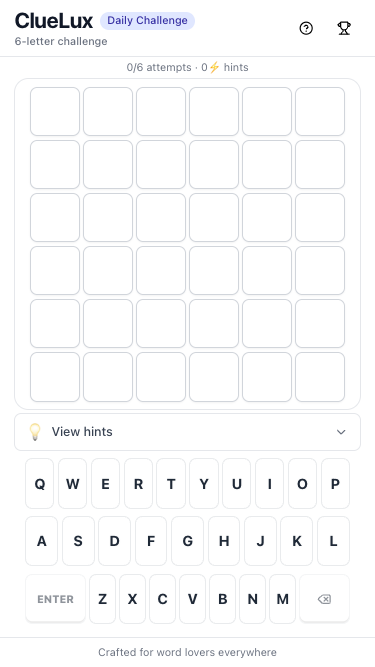
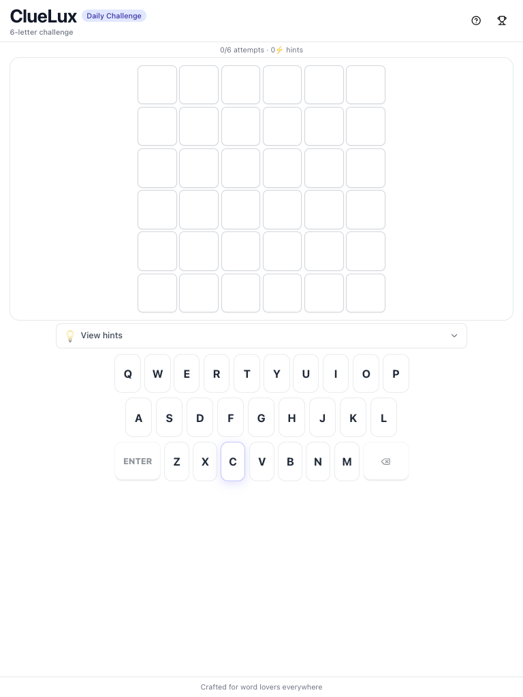
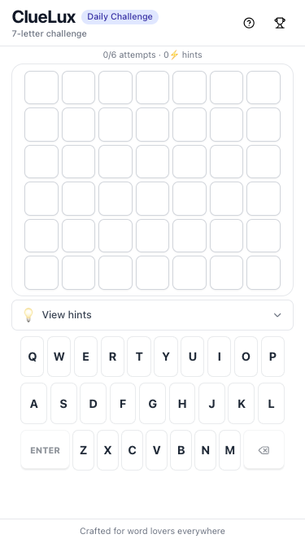
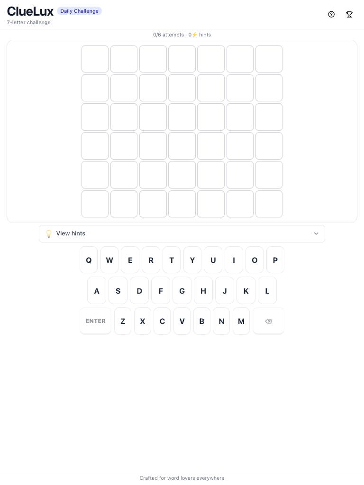
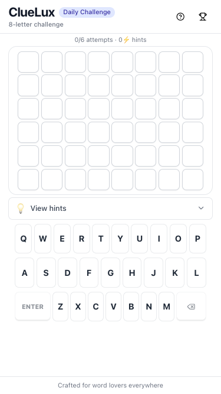
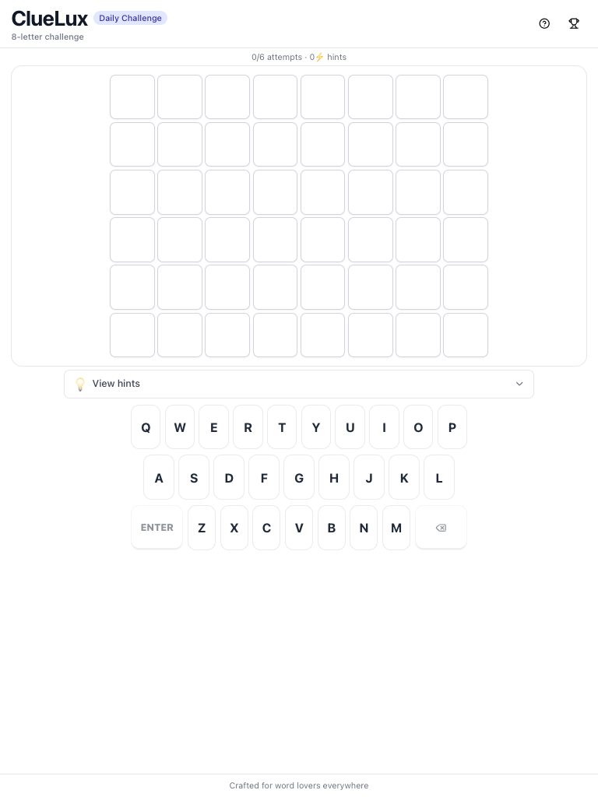
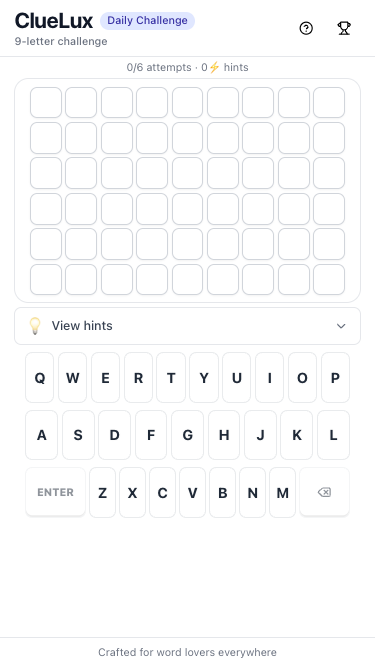
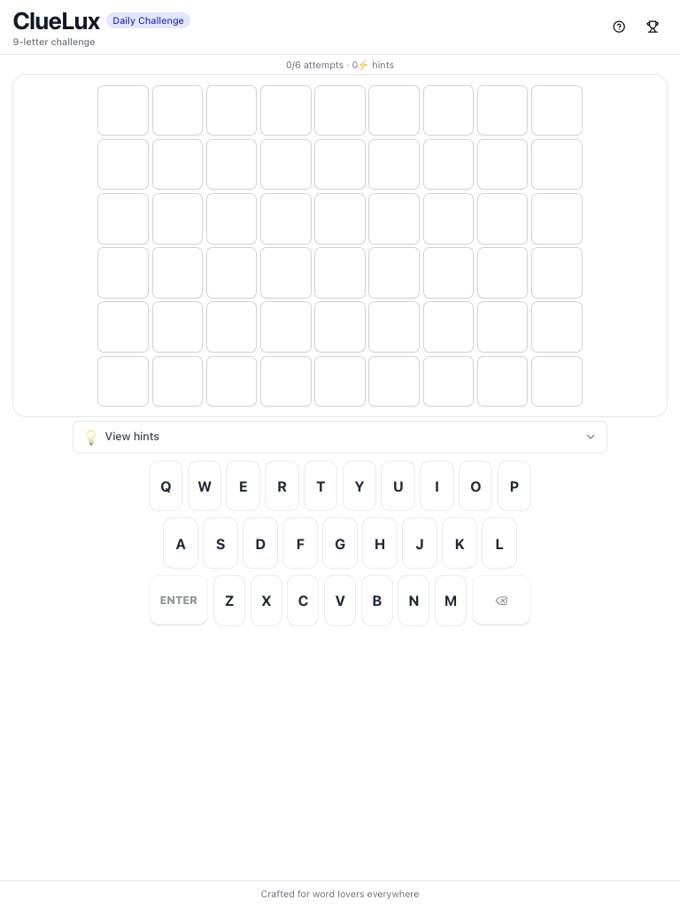

# Responsive verification

Real screenshots, not just reasoning about CSS — captured against the live UAT backend with a different real word loaded for each length, so what's shown below is exactly what the app rendered, not a mockup.

**Confirmed max word length in practice: 9 letters** (the code technically supports up to 12, and that was verified too — see `testing.md` — but 9 is the real ceiling for actual daily words going forward).

Each word below is shown at two widths: **375px** (the most common small-phone width — iPhone SE/mini-class devices) and **768px** (tablet / foldable-unfolded class). Tile size is fluid (`clamp()` + `vmin`, scaled by word length — see `frontend.md` and the commit this came from), so it should visibly shrink to fit the longer words rather than overflow.

## 6 letters — GARDEN

| 375px | 768px |
|---|---|
|  |  |

## 7 letters — JOURNEY

| 375px | 768px |
|---|---|
|  |  |

## 8 letters — PARADISE

| 375px | 768px |
|---|---|
|  |  |

## 9 letters — ADVENTURE

| 375px | 768px |
|---|---|
|  |  |

## What to look for

- Tiles get visibly smaller as word length increases at the same width (compare GARDEN's 6 tiles to ADVENTURE's 9 at 375px) — that's the fluid sizing working, not a bug.
- The keyboard never changes size or overflows regardless of word length — it's sized independently of the board.
- At 768px, tiles hit their upper size cap (64px) rather than growing indefinitely — the board stays a sensible size on larger screens instead of becoming oversized.
- Zero horizontal scrolling in any of the eight screenshots above.

## How these were produced

Each word was loaded directly into the isolated UAT DynamoDB table (`ClueLuxWords-uat`) under the same test date, with the local frontend's `.env.local` pointed at the UAT API (see `testing.md`). This is the same workflow to use for checking any future word-length change — it takes a few minutes and produces real evidence instead of a guess.
